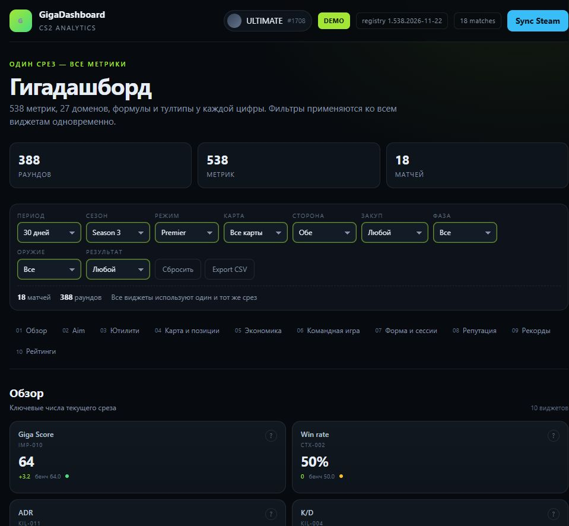

# CS2 GigaDashboard

Локальный дашборд всей статистики CS2: 538 метрик, 27 доменов, формулы и тултипы у каждой цифры, один гигадашборд с общими фильтрами.



- ТЗ: [`docs/TZ-gigadashboard.md`](docs/TZ-gigadashboard.md)
- Хостинг и домен: [`docs/HOSTING.md`](docs/HOSTING.md)
- Деплой на Northflank: [`deploy/NORTHFLANK.md`](deploy/NORTHFLANK.md)
- Публичный стенд: [`docs/DEPLOYED.md`](docs/DEPLOYED.md) → https://cs2-gigadashboard.onrender.com
- Подключение Steam: [`docs/STEAM.md`](docs/STEAM.md)
- История матчей и источники: [`docs/HISTORY.md`](docs/HISTORY.md)
- План реализации: [`docs/ROADMAP.md`](docs/ROADMAP.md)
- Реестр метрик: [`data/metrics.yaml`](data/metrics.yaml) (генерируется из ТЗ)

## Быстрый старт

```bash
npm install
npm run seed        # 24 синтетических матча + значения всех 538 метрик
npm run dev         # API :8787 + Vite :5173
```

Открыть `http://localhost:5173`.

Production:

```bash
npm run build
npm run start       # http://127.0.0.1:8787, статика + API
```

## Что уже работает

- Реестр из 538 метрик, сгенерированный из ТЗ: ID, домен, единица, направление, минимальная выборка, формула, include/exclude, источники.
- SQLite-схема: матчи, игроки, раунды, значения метрик, состояние синка.
- API: `/api/dashboard`, `/api/metrics`, `/api/metrics/:id`, `/api/matches`, `/api/matches/:id`, `/api/export.csv`, `/api/sharecode`, `/api/steam/status`.
- Гигадашборд: 10 секций, 100+ виджетов, sticky-фильтры (период, сезон, режим, карта, сторона, закуп, фаза, оружие, результат), чипы активных фильтров, permalink.
- Тултипы: hover-карточка и боковая панель с формулой, единицей, N, уверенностью, бенчмарком, перцентилем и источниками.
- Виджеты: KPI, line, bar, radar, scatter, таблицы, сетка карт, список матчей.
- Basic Auth через `APP_USER` / `APP_PASSWORD`.
- Кодек share-кодов (decode/encode, тесты), Web API walker `GetNextMatchSharingCode`, последовательная GC-очередь.
- Steam-логин: пароль/QR, Steam Guard (email/TOTP/device), шифрованный refresh-token, автозапуск GC-воркера.
- Импорт последних матчей из GC и парсинг демок: карта, имена, K/D/A, ADR, KAST, HLTV 2.0, киллфид, раунды, shots, damage, grenades, positions.
- Импорт истории Leetify: 540+ матчей с 2021 года, ADR/Aim/Utility/Positioning/Leetify Rating.
- Dockerfile, compose, примеры Caddy/Cloudflared/systemd.

## Демо-данные

Пока `GIGA_DEMO=1`, сервер отдаёт синтетический датасет и показывает бейдж **DEMO**. Значения метрик генерируются детерминированно и не являются реальной статистикой. Это нужно, чтобы верстать и проверять весь дашборд до подключения Steam/GC.

## Структура

```
apps/server       Fastify + SQLite + реестр + демо-датасет
apps/web          React + Vite + Recharts
packages/shared   общие типы
data/metrics.yaml реестр метрик (auto-generated)
docs/             ТЗ и хостинг
scripts/          парсер ТЗ -> YAML
```

## Команды

| Команда | Что делает |
|---|---|
| `npm run dev` | сервер + веб с HMR |
| `npm run build` | сборка shared/server/web |
| `npm run start` | production-сервер |
| `npm run seed` | пересоздать демо-данные |
| `npm run typecheck` | проверка типов |
| `npm test` | тесты реестра и share-кодов |
| `npm run demos:parse` | скачать и распарсить доступные демки (локально) |
| `npm run metrics:sync` | перегенерировать `data/metrics.yaml` из ТЗ |

## Дальше по плану

1. Steam-логин: `steam-user` + `steam-session`, Steam Guard, refresh-token в DPAPI/AES-GCM.
2. GC-синк: `node-cs2`, `requestGame(shareCode)`, очередь, дедуп, `last_share_code`.
3. Парсер демок: `@laihoe/demoparser2`, нормализация в `shots/kills/damage/grenades/positions`.
4. Калькуляторы метрик: первый вертикальный срез KIL/ACC/AIM/UTL/ECO.
5. Реальные агрегаты и бенчмарки вместо демо-значений.
6. Live-режим и 2D/3D-реплей.

## Предупреждения

- Проект не аффилирован с Valve. Giga Score — не официальный рейтинг.
- Reference-рейтинги (HLTV, Leetify, CSDB, Refrag, CSRep) — аппроксимации; формулы помечены в реестре.
- Не публикуйте приложение без Basic Auth/Cloudflare Access: оно показывает историю матчей и настройки.
